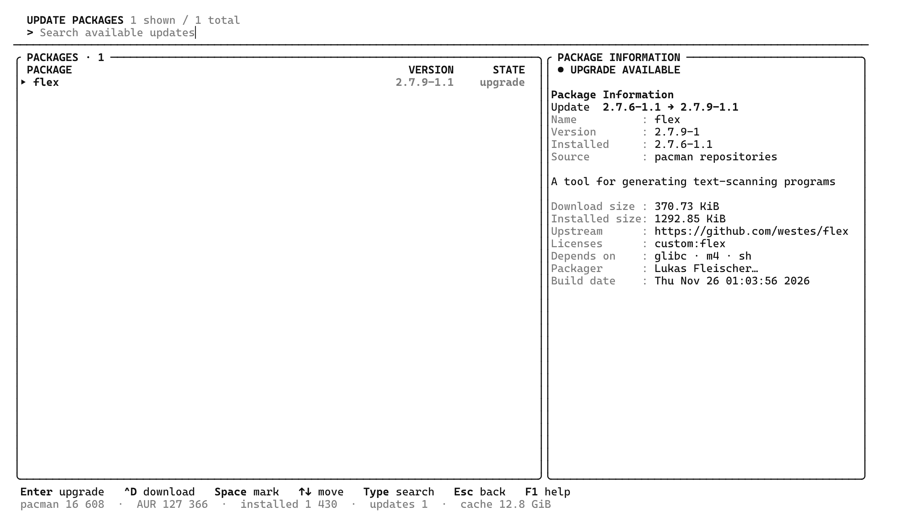
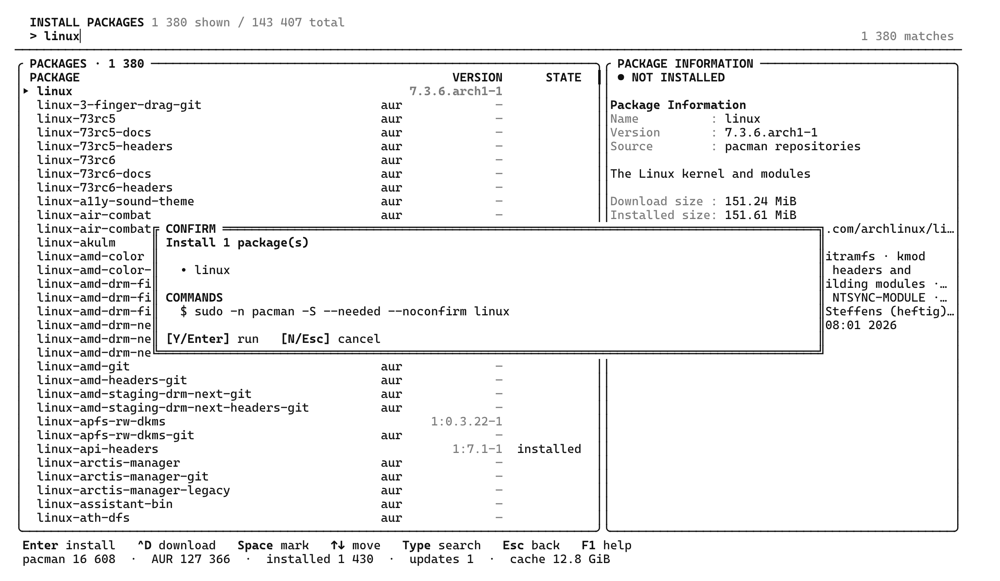

# PPM — Powerful Package Manager

A Rust + ratatui TUI for Arch Linux / CachyOS: every package from **all**
configured pacman repositories and from the **AUR** is merged into a single flat
list — no repository grouping. Search, inspect metadata, download packages and
run full pacman operations (install / remove / upgrade / downgrade / clean).

```
██████  ██████  ██    ██
██  ██  ██  ██  ███  ███
██████  ██████  ██ ██ ██
██      ██      ██    ██
██      ██      ██    ██
```
*Powerful Package Manager · pacman + AUR in one flat list*


## Features

- **One flat package list.** `pacman -Sl` (core / extra / multilib / cachyos-* …)
  and the complete AUR name list (127,000+ names) are merged, duplicates are
  collapsed and the result is sorted by name. Repositories are never grouped
  anywhere; the only trace of origin is a small `aur` tag on packages that are
  missing from the sync databases.
- **Search.** Filter-as-you-type with ranking: exact match → prefix → substring.
  Each package shows its state: `installed`, `upgrade`, `newer`, `NOT INSTALLED`.
- **Information pane.** Name, available and installed versions, description,
  sizes, licenses, dependencies, optional dependencies, conflicts, provides,
  packager/build date; for AUR — maintainer, votes, popularity, out-of-date
  date. Metadata is fetched lazily (debounce + cache), so the list stays fast.
- **Downloads.** `Ctrl+D` downloads the selected/marked packages:
  - pacman packages via the URL resolved by `pacman -Spdd` (including `file://`
    copies from the package cache);
  - AUR packages as snapshot tarballs
    (`aur.archlinux.org/cgit/aur.git/snapshot/<pkg>.tar.gz`);
  - a progress bar with percent, bytes, speed and file counter; `Esc` cancels
    and removes the `.part` file.
- **Install and maintenance.** Install / Remove / Update / Downgrade / Clean
  orphans / Clean cache / System tools. Every mutating command is shown in a
  confirmation dialog together with its exact command line; command output is
  streamed into an overlay console; after a successful operation the data is
  reloaded automatically.
- **AUR.** Packages are built and installed through `yay` or `paru`
  (auto-detected); AUR updates are checked for installed foreign packages.
- **Monochrome, minimal UI.** No colours and no background fills: text uses the
  terminal's default foreground/background, hierarchy comes from `bold`/`dim`
  and glyphs only. The terminal theme shows through as-is.
- **Fully asynchronous.** All external calls run in tokio tasks, the UI redraws
  at 8 fps and never blocks; data sources arrive as they become ready.
- **No TTY required.** `ppm-rs --snapshot DIR` renders every screen into
  `.txt`/`.html` files (this is how the screenshots and visual checks are made).

## Screenshots

| | |
|---|---|
|  |  |
|  |  |
|  |  |
|  |  |

All 11 screens live in [`screenshots/`](screenshots) (PNG + text dumps).
They are rendered on a neutral white canvas — the TUI itself defines neither
colours nor background and inherits the terminal theme.

## Build and run

Requirements: an Arch-based Linux with pacman (CachyOS works great), Rust 1.88+.
For AUR operations — `yay` or `paru`.

```bash
cargo build --release
./target/release/ppm-rs
```

The Cargo package and the executable are both called **`ppm-rs`**.
`cargo install --path .` installs the `ppm-rs` command.

In this working copy the toolchain is installed locally and excluded from git:

```bash
source .toolchain/env.sh
cargo build --release
```

Environment variables:

| Variable | Default | Purpose |
|---|---|---|
| `PPM_CACHE_DIR` | `$XDG_CACHE_HOME/ppm` → `~/.cache/ppm` (fallback `./.ppm-cache`) | AUR package list cache |
| `PPM_DOWNLOADS_DIR` | `./downloads` | where packages are downloaded |

> **A note on sudo.** The TUI never asks for a password: system commands run as
> `sudo -n …`. Before starting, run `sudo -v` in a regular terminal (credentials
> are cached for the session) or start PPM as root. If sudo is unavailable, the
> error is shown honestly in the operation console. The AUR helper (`yay`/`paru`)
> also needs sudo for `pacman -U`.

## Key bindings

### Global

| Key | Action |
|---|---|
| `↑`/`↓`, `j`/`k` | move through the menu |
| `Enter` | select / run |
| `Esc` | go back (in the browser it clears the search first) |
| `F1` / `?` | help |
| `R` | reload data (main menu) |
| `Ctrl+C` | quit |

### Package browser

| Key | Action |
|---|---|
| typing | filter the single package list |
| `Backspace` | delete a character |
| `Ctrl+U` | clear the search |
| `Enter` | install / remove / upgrade / reinstall from cache |
| `Ctrl+D` | **download** the selected packages into `downloads/` |
| `Space` | mark a package for a batch operation |
| `Ctrl+R` | reload data |

### Maintenance screens

| Screen | Keys |
|---|---|
| Remove / Update / Downgrade | same as the browser (`Enter`, `Space`, `Esc`) |
| Orphans | `Enter` — remove all orphans, `r` — rescan |
| Cache | `Enter` — `pacman -Sc`, `r` — rescan the cache |
| System tools | `↑`/`↓` + `Enter`: refresh DB, full upgrade, update AUR, reload, clear AUR cache |

## How it works

| Part | Data source |
|---|---|
| package list | `pacman -Sl` (all repos), `pacman -Q`, `pacman -Qm`, `pacman -Qu` |
| pacman metadata | `pacman -Si`, fallback `pacman -Qi` for local packages |
| download URL | `pacman -Spdd --print-format %n\|%v\|%l\|%s <pkg>` |
| AUR list | `https://aur.archlinux.org/packages.gz` (6 h cache, stale-cache fallback) |
| AUR metadata | `https://aur.archlinux.org/rpc/v5/info` in batches of 50 |
| version comparison | own port of `alpm_pkg_vercmp` (parseEVR + rpmvercmp + final showdown) |
| downloads | `reqwest` + rustls, streaming, progress and cancellation |

All pacman calls run with `LC_ALL=C` for stable parsing. Commands are executed
without a TTY (`stdin = null`, `kill_on_drop`), so the TUI cannot hang on an
interactive question; confirmations are asked by PPM itself.

## Tests and checks

```bash
cargo test                 # 23 unit tests: parsers, vercmp vs the system vercmp, filtering, app state
cargo clippy --all-targets # clean
python3 scripts/pty-smoke.py                     # end-to-end in a real PTY
./scripts/render-screenshots.sh screenshots      # PNG from snapshot mode (headless Chromium)
```

`scripts/pty-smoke.py` boots the real TUI in a pty, emulates the screen and
verifies: main menu → browser → metadata → install dialog (cancelled) → a real
`cowsay` download through `Ctrl+D` → back to the menu → AUR metadata loading →
clean exit with code 0.

## Structure

```
src/
  main.rs         terminal, event loop, CLI (--snapshot/--help/--version)
  app.rs          state, screens, actions, confirmations, data loading
  event.rs        background task events
  model.rs        packages, statuses, PkgInfo, vercmp port, formatting
  exec.rs         external command execution, log streaming, sudo/helper detection
  download.rs     HTTP/file downloads with progress and cancellation
  snapshot.rs     headless screen rendering to txt/html
  repo/
    pacman.rs     pacman queries, parsers, cache scanning
    aur.rs        AUR list, RPC, snapshot URLs
  ui/
    mod.rs        theme helpers, footer, shared widgets
    menu.rs       main menu
    browse.rs     browser: search, list, scrollbar
    info.rs       "Package Information" pane
    simple.rs     orphans / cache / system tools
    overlay.rs    confirm / operation console / help
scripts/
  pty-smoke.py            end-to-end check in a pseudo-terminal
  render-screenshots.sh   html → png
```

## Limitations

- An AUR "download" is a **source snapshot** (PKGBUILD and files), not a built
  package; AUR installation goes through `yay`/`paru`.
- AUR updates are only checked for already installed foreign packages.
- Directly downloaded tarballs are not signature-verified (pacman verifies
  signatures/integrity when installing); use `pacman`/the helper to install.
- "Clean cache" runs `pacman -Sc --noconfirm` without interactive questions.
- No mirror selection and no manual pacman config editing.

## License

MIT.
