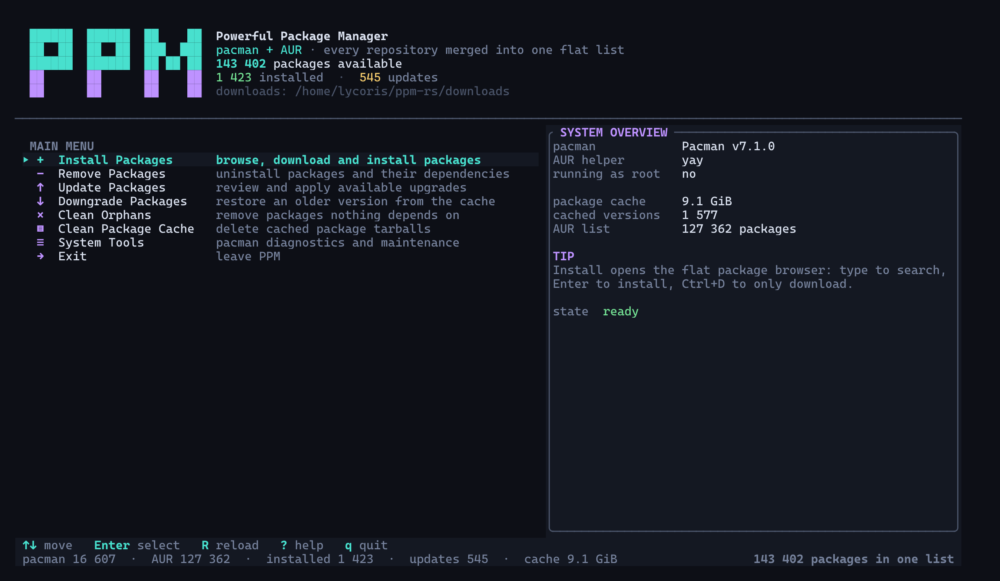
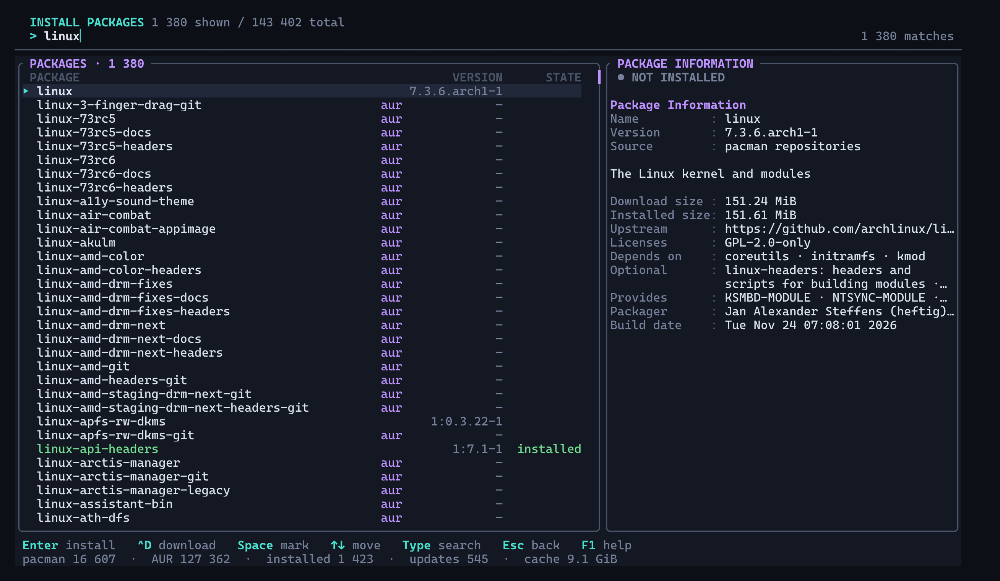
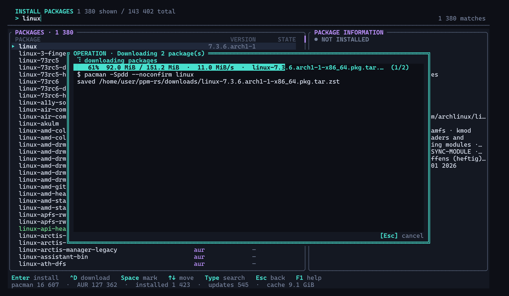
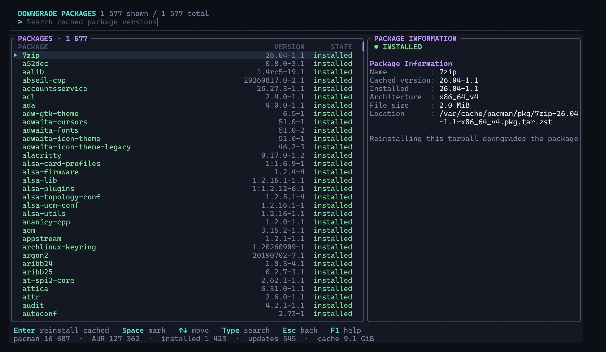
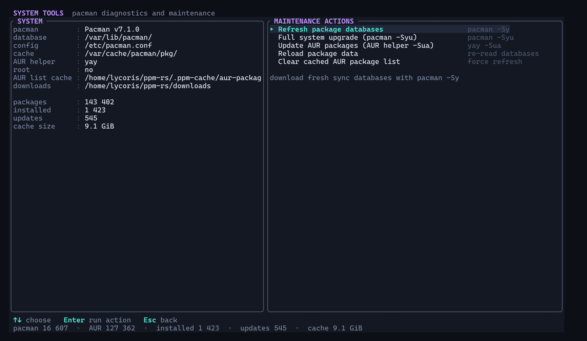
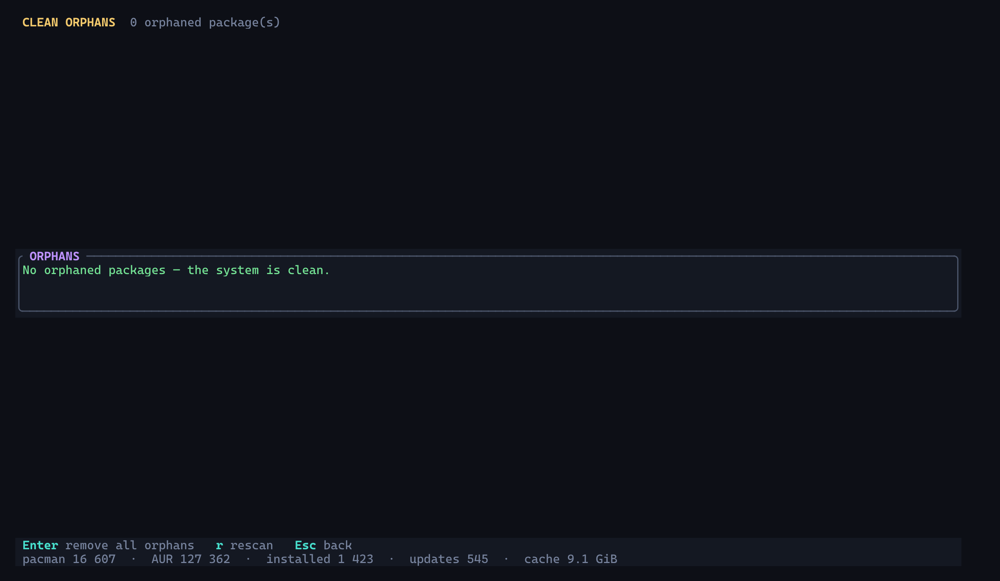
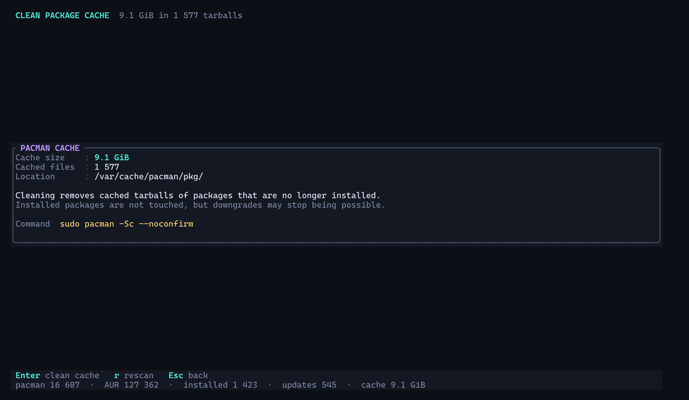

# PPM — Powerful Package Manager

TUI-утилита на **Rust + ratatui** для Arch Linux / CachyOS: все пакеты из **всех**
настроенных репозиториев pacman и из **AUR** сливаются в один плоский список —
без разделения по репозиториям. Поиск, просмотр метаданных, скачивание пакетов и
полноценные операции pacman (install / remove / upgrade / downgrade / clean).

```
██████  ██████  ██    ██
██  ██  ██  ██  ███  ███
██████  ██████  ██ ██ ██
██      ██      ██    ██
██      ██      ██    ██
```
*Powerful Package Manager · pacman + AUR, один плоский список*



## Возможности

- **Единый список пакетов.** `pacman -Sl` (core / extra / multilib / cachyos-* …)
  и полный список AUR (127 000+ имён) объединяются, дубликаты схлопываются,
  сортировка по имени. Репозитории нигде не группируются; в интерфейсе есть лишь
  маленькая метка `aur` у пакетов, которых нет в sync-базах.
- **Поиск.** Фильтр по мере ввода с ранжированием: точное совпадение → префикс →
  подстрока. Состояние каждого пакета: `installed`, `upgrade`, `newer`,
  `NOT INSTALLED`.
- **Панель информации.** Имя, версия (доступная и установленная), описание,
  размеры, лицензии, зависимости, опциональные зависимости, конфликты, provides,
  packager/build date; для AUR — мейнтейнер, голоса, popularity, out-of-date date.
  Метаданные подгружаются лениво (debounce + кэш), панель не тормозит список.
- **Скачивание.** `Ctrl+D` качает выбранные/помеченные пакеты:
  - из pacman — по URL, который резолвит `pacman -Spdd` (включая `file://` из кэша);
  - из AUR — snapshot tarball (`aur.archlinux.org/cgit/aur.git/snapshot/<pkg>.tar.gz`);
  - прогресс-бар с процентом, байтами, скоростью и счётчиком файлов; `Esc` —
    отмена с очисткой `.part`.
- **Установка и обслуживание.** Install / Remove / Update / Downgrade / Clean
  orphans / Clean cache / System tools. Перед изменяющей командой — диалог
  подтверждения с точной командной строкой; вывод команд транслируется в
  оверлей-консоль; после успешной операции данные перезагружаются автоматически.
- **AUR.** Пакеты ставятся/обновляются через `yay` или `paru` (автоопределение),
  обновления AUR проверяются для установленных foreign-пакетов.
- **Асинхронность.** Все внешние вызовы — в tokio-задачах, UI рисуется на 8 fps и
  не блокируется; параллельные загрузки данных приходят по мере готовности.
- **Без TTY.** `ppm --snapshot DIR` рендерит все экраны в `.txt`/`.html` (на этом
  построены скриншоты и визуальные проверки).

## Скриншоты

| | |
|---|---|
|  |  |
|  |  |
|  |  |
|  |  |

Все 11 экранов лежат в [`screenshots/`](screenshots) (PNG + текстовые дампы).

## Сборка и запуск

Требования: Arch-based Linux с pacman (CachyOS подходит идеально), Rust 1.88+.
Для AUR-операций — `yay` или `paru`.

```bash
cargo build --release
./target/release/ppm
```

В этой рабочей копии тулчейн установлен локально и исключён из git:

```bash
source .toolchain/env.sh   # RUSTUP_HOME/CARGO_HOME/PATH внутри .toolchain
cargo build --release
```

Переменные окружения:

| Переменная | По умолчанию | Назначение |
|---|---|---|
| `PPM_CACHE_DIR` | `$XDG_CACHE_HOME/ppm` → `~/.cache/ppm` (fallback `./.ppm-cache`) | кэш списка AUR |
| `PPM_DOWNLOADS_DIR` | `./downloads` | куда качать пакеты |

> **Важно про sudo.** TUI не вводит пароль: системные команды запускаются как
> `sudo -n …`. Перед запуском выполните `sudo -v` в обычном терминале (кэш
> credentials на сессию), либо запустите PPM от root. Если sudo недоступен,
> ошибка честно отобразится в консоли операции. AUR-хелперу (`yay`/`paru`) sudo
> тоже нужен для `pacman -U`.

## Управление

### Глобально

| Клавиша | Действие |
|---|---|
| `↑`/`↓`, `j`/`k` | перемещение по меню |
| `Enter` | выбрать / выполнить |
| `Esc` | назад (в браузере — сначала очищает поиск) |
| `F1` / `?` | помощь |
| `R` | перечитать данные (меню) |
| `Ctrl+C` | выход |

### Браузер пакетов

| Клавиша | Действие |
|---|---|
| печать | фильтр по единому списку |
| `Backspace` | удалить символ |
| `Ctrl+U` | очистить поиск |
| `Enter` | установить / удалить / обновить / переустановить из кэша |
| `Ctrl+D` | **скачать** выбранные пакеты в `downloads/` |
| `Space` | пометить пакет для пакетной операции |
| `Ctrl+R` | перечитать данные |

### Экраны обслуживания

| Экран | Клавиши |
|---|---|
| Remove / Update / Downgrade | как в браузере (`Enter`, `Space`, `Esc`) |
| Orphans | `Enter` — удалить все найденные сироты, `r` — пересканировать |
| Cache | `Enter` — `pacman -Sc`, `r` — пересканировать кэш |
| System tools | `↑`/`↓` + `Enter`: refresh DB, full upgrade, update AUR, reload, clear AUR cache |

## Как это работает

| Часть | Источник данных |
|---|---|
| список пакетов | `pacman -Sl` (все репо), `pacman -Q`, `pacman -Qm`, `pacman -Qu` |
| метаданные pacman | `pacman -Si`, fallback `pacman -Qi` для локальных пакетов |
| URL для скачивания | `pacman -Spdd --print-format %n\|%v\|%l\|%s <pkg>` |
| список AUR | `https://aur.archlinux.org/packages.gz` (кэш 6 ч, fallback на устаревший кэш) |
| метаданные AUR | `https://aur.archlinux.org/rpc/v5/info` батчами по 50 |
| сравнение версий | собственный порт `alpm_pkg_vercmp` (parseEVR + rpmvercmp + «final showdown») |
| скачивание | `reqwest` + rustls, стриминг, прогресс и отмена |

Все вызовы pacman идут с `LC_ALL=C`, чтобы парсинг был стабильным. Команды
запускаются без TTY (`stdin = null`, `kill_on_drop`), поэтому TUI не может
зависнуть из-за интерактивного вопроса; подтверждения спрашивает сам PPM.

## Тесты и проверки

```bash
cargo test                 # 23 unit-теста: парсеры, vercmp vs системный vercmp, фильтр, app-state
cargo clippy --all-targets # чисто
python3 scripts/pty-smoke.py          # end-to-end в реальном PTY
./scripts/render-screenshots.sh screenshots   # PNG из snapshot-режима (headless chromium)
```

`scripts/pty-smoke.py` поднимает настоящий TUI в pty, эмулирует экран и проверяет:
главное меню → браузер → метаданные → диалог установки (отмена) → реальное
скачивание `cowsay` через `Ctrl+D` → возврат в меню → загрузка AUR-метаданных →
чистый выход с кодом 0.

## Структура

```
src/
  main.rs         терминал, event loop, CLI (--snapshot/--help/--version)
  app.rs          состояние, экраны, действия, подтверждения, загрузка данных
  event.rs        события фоновых задач
  model.rs        пакеты, статусы, PkgInfo, порт vercmp, форматирование
  exec.rs         запуск внешних команд, стриминг логов, sudo/хелперы
  download.rs     HTTP/file-скачивание с прогрессом и отменой
  snapshot.rs     headless-рендер экранов в txt/html
  repo/
    pacman.rs     запросы и парсеры pacman, сканирование кэша
    aur.rs        список AUR, RPC, snapshot-URL
  ui/
    mod.rs        тема, футер, общие виджеты
    menu.rs       главное меню
    browse.rs     браузер: поиск, список, скроллбар
    info.rs       панель «Package Information»
    simple.rs     orphans / cache / system tools
    overlay.rs    confirm / operation console / help
scripts/
  pty-smoke.py            e2e-проверка в псевдотерминале
  render-screenshots.sh   html → png
```

## Ограничения

- AUR-скачивание — это **snapshot исходников** (PKGBUILD и файлы), а не собранный
  пакет; установка AUR идёт через `yay`/`paru`.
- Обновления AUR проверяются только для уже установленных foreign-пакетов.
- Скачанные напрямую tarball'ы не проверяются по подписи (подпись/целостность
  проверяет pacman при установке); для установки используйте `pacman`/helper.
- «Очистить кэш» выполняет `pacman -Sc --noconfirm` — без интерактивных вопросов.
- Нет выбора зеркал и ручного редактирования конфигов pacman.

## Лицензия

MIT.
